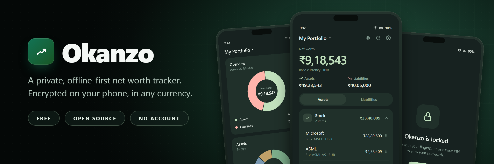
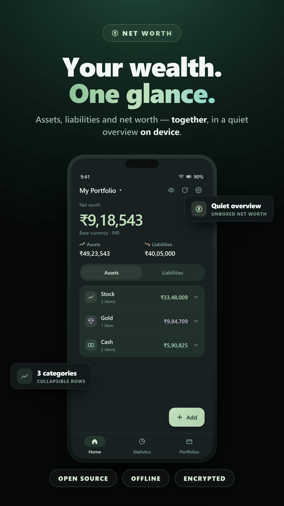
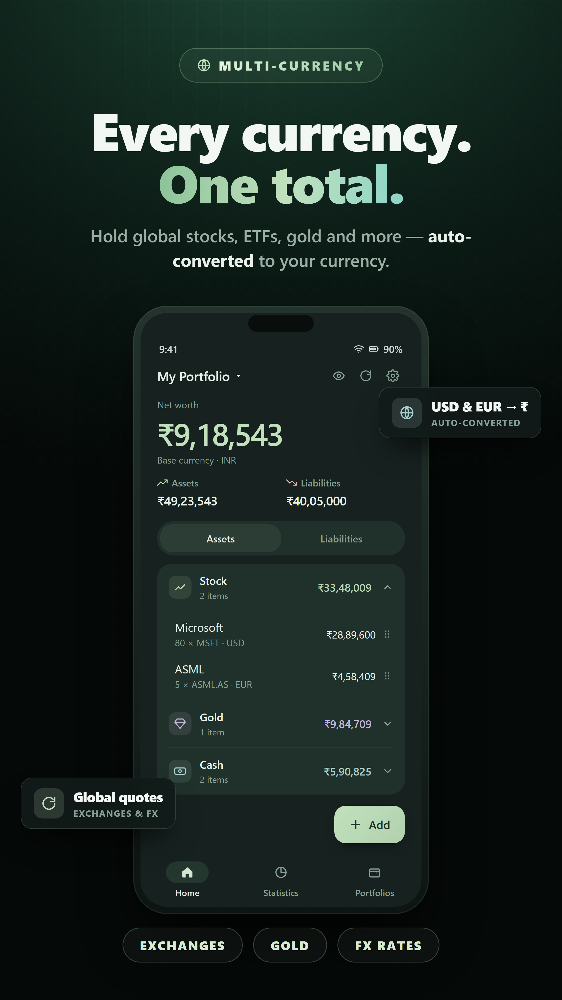
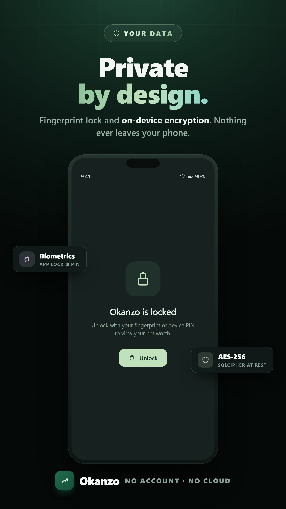
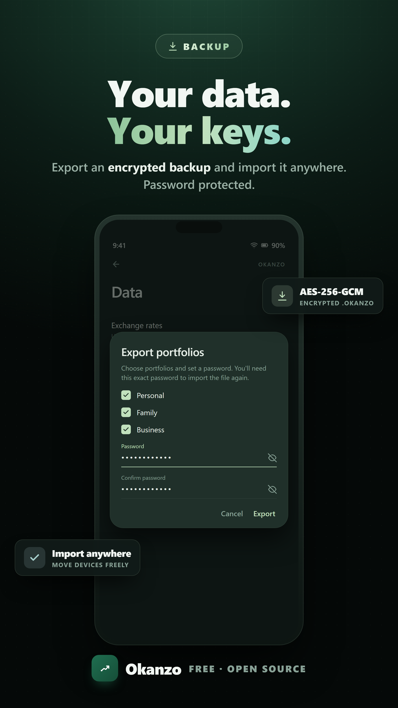

<div align="center">



</div>

---

<div align="center">

### Okanzo


### A private, offline-first net worth tracker

Track your assets and liabilities across currencies and portfolios — encrypted on your device, with no accounts and no cloud.

<br/>

<p>
  
  
  
  
  
  
</p>

<br/>

<a href="https://f-droid.org/packages/com.cairnlabworks.okanzo/"></a>
&nbsp;
<a href="https://github.com/cairn-labworks/Okanzo/releases"></a>

<br/>

<sub>
  <a href="#features">Features</a> ·
  <a href="#coming-from-an-earlier-release">Migration</a> ·
  <a href="#download">Download</a> ·
  <a href="#privacy">Privacy</a> ·
  <a href="#translations">Translations</a> ·
  <a href="#building">Building</a> ·
  <a href="#quality-checks">Quality checks</a>
</sub>

</div>

---

<div align="center">









<sub><b>Quiet overview</b> · <b>Statistics</b> · <b>Multi-currency</b> · <b>Private by design</b> · <b>Portfolios</b> · <b>Encrypted backup</b></sub>

</div>

---

## Overview

Okanzo is an open source, offline-first app for tracking your **net worth** — your assets minus your liabilities — organised into portfolios, built with Flutter and Material 3 for **Android**.

Your financial data is stored **encrypted on your device** and never leaves it, except when you deliberately export an encrypted backup. No accounts, no analytics, no ads.

---

## Features

<table>
<tr>
<td width="50%" valign="top">

### Quiet overview & portfolios

- Unboxed net-worth headline, tonal **Assets** and **Liabilities** tiles, an **equity vs. obligations** coverage bar, and compact **Assets** and **Liabilities** tabs
- A single quiet panel with **collapsible category rows** showing category totals, item counts, and 1-decimal percentage shares until expanded, plus **Quick-Find** holding filtering and **Expand / Collapse all**
- **Simple net worth** (`Settings → Currency → Simple net worth`) shortens only the home headline from 1,000 upward (`$7K`, `$165.3M`, or `₹1.65 Cr` in INR lakh/crore) while keeping detailed totals exact
- **Multiple portfolios** (*Personal*, *Family*, *Business*), each with a distinct name (ignoring case and surrounding spaces), explicit **Viewing** vs. **Default** badges, and 1-tap switching
- **Custom ordering**: long-press and drag to reorder categories; arrange holdings inside a category using its **Sort or arrange** menu
- **Canvas holding entry**: the compact bottom-right **Add holding** button expands in place over a blurred background, without moving the portfolio list. Choose **An asset** or **A liability**. The amount-led editors use outlined fields and searchable type/currency/exchange dialogs. A live **Estimated value** for assets or **Outstanding amount** for liabilities appears above the pinned Save button. Name or Custom name identifies each holding, without a separate Notes field; previously stored notes remain preserved. Switch between asset and liability tabs without losing either draft; Back protects unsaved changes, and Save is available once the required fields are valid.
- **Amount precision**: if an amount or quantity would lose digits when saved, the editor keeps what you typed and disables Save until you correct it. This also applies to large whole numbers.
- **Holding details and order**: tap a holding for its valuation provenance (**Market quote** vs. **Manual valuation**), converted base-currency value, portfolio percentage share bar, Edit, or isolated confirmed Delete. The category's **Sort or arrange** menu offers name/value sorting and **Arrange manually**; saved custom order is preserved when trying other sorts. Sort choices are session-scoped and separate for each portfolio/category.
- **Readable names and quotes**: newly entered names and custom names are limited to 60 user-perceived characters, with a counter. Search suggestions appear directly below the search field. Tap a selected market holding to search again; selecting a stock, fund or crypto listing fetches its price once automatically, without waiting for a quantity. An unavailable quote does not block saving offline.

</td>
<td width="50%" valign="top">

### Global markets & multi-currency

- Track **stocks, mutual funds/ETFs, crypto, precious metals, cash, bank deposits, real estate, vehicles, bonds**, plus **loans, mortgages, credit cards, pending payments and taxes**
- **Valuables**: track metals, diamonds, other gemstones, jewellery and other precious items. Choosing Gold, Silver, Platinum or Palladium opens its purity picker directly. **By weight** multiplies grams by an editable price per gram: available purity-adjusted futures quotes prefill it, or enter a custom rate. **Total value** hides weight/rate and uses your estimate or appraisal; gems and jewellery start in this mode. Both modes retain their inputs when switching and editing. Rates and totals accept finite positive decimals; offline, enter a custom rate or total. Automatic refresh never overwrites custom rates or total valuations. Existing Gold holdings keep their legacy manual price under Valuables.
- **International exchanges**: NYSE/Nasdaq, Shanghai, Tokyo, Hong Kong, BSE and NSE (India), and Euronext Paris, Amsterdam, Brussels, Lisbon, Dublin, Oslo and Milan — or **Other / full Yahoo ticker** (`000001.SZ`, `VOD.L`, `SHOP.TO`). NSE tickers use `.NS`, such as `RELIANCE.NS`. Quotes in minor units (such as British pence) convert automatically; [Yahoo Finance coverage](https://help.yahoo.com/kb/finance/complete-list-markets-exchanges-yahoo-finance-sln2310.html) applies
- **Preferred exchanges** shortlist starting with **US (NYSE / Nasdaq)**, customisable via **Select preferred exchanges...** (including an empty shortlist) while preserving existing holdings
- **Company, coin or ticker search**: type at least two characters in the stock, fund or crypto search field for Yahoo Finance suggestions showing the name and ticker, plus the exchange for stocks/funds. Crypto suggestions show full trading pairs such as `BTC-USD`; explicit non-USD pairs are preserved. Select a listing to fill its symbol and use its fetched name automatically, or enter an optional **Custom name** to override it in lists. Manual ticker entry still works offline or when search is unavailable
- **Smart crypto & FX conversion**: bare crypto tickers (`BTC` → `BTC-USD`, explicit `BTC-EUR` preserved), quote-to-holding currency conversion without resetting your chosen currency, and automatic portfolio conversion into your base currency

</td>
</tr>
<tr>
<td width="50%" valign="top">

### Focused forms & statistics

- **Focused entry forms**: a large page heading leads into the value or live estimate, compact type/currency/exchange chips (long-press the exchange chip for suffix guidance), paired underlined valuation fields with distinct labels and muted placeholders, expandable optional notes and an inline save button
- **Guided field entry**: selecting an editor option or pressing **Next/Enter** in a single-line input moves to the next empty required field, skipping completed and optional fields. Finishing closes the keyboard; tap **Save** to save.
- **Statistics**: interactive donut charts breaking down overview (assets vs. liabilities), assets by category and warm-terracotta liabilities by category in your base currency, with 1-decimal percentage shares alongside amounts in every legend row
- **What's new** highlights after installing or updating (`Settings → About → What's new`), separate from **Settings → About → Okanzo** app & licence details

</td>
<td width="50%" valign="top">

### Mineral Ledger, Midnight & 21 languages

- **Unified precision UI**: warm alabaster and stone surfaces in Light mode, deep-green Midnight surfaces in Dark mode, sage accents, non-alarmist warm terracotta liabilities, tabular number typography, quiet inset cards and subtle separators across every screen
- Single **Settings → Appearance → Theme** control: **Light** uses the warm mineral & sage palette, **Dark** uses **Midnight**, and **System default** follows the device. Wallpaper-derived colors are no longer used.
- **Grouped settings** (**Appearance**, **Currency**, **Security**, **Data**, **About**) and adaptive navigation (bottom bar on phones, navigation rail on tablets and wide windows)
- **21 languages** with immediate override or automatic device-language selection, including right-to-left Arabic layout

</td>
</tr>
<tr>
<td width="50%" valign="top">

### Security & privacy

- Local database encrypted at rest with **SQLCipher (AES-256)**, keyed through **Android Keystore**
- Optional **app lock** with fingerprint, biometrics or device PIN protects every screen and dialog, preserves unsaved edits behind the lock, and prompts only on foreground resume. Enabling/disabling the lock and exporting while it is enabled require authentication. Backup file pickers have a single-use 60-second handoff; longer absences re-lock the app. If device credentials are removed, Okanzo stays locked and explains how to restore access.
- **Screenshot protection**: `FLAG_SECURE` on Android prevents screen captures and recent-apps previews by default, with a toggle under **Settings → Security → Block screenshots**
- **Hide balances** masks every monetary figure behind `••••` and omits holding quantities across Home, Statistics, and Portfolios in one tap

</td>
<td width="50%" valign="top">

### Encrypted backups

- Export selected portfolios — or all of them — into a single password-protected `.okanzo` file (**AES-256-GCM** with **PBKDF2-HMAC-SHA256**)
- The export dialog starts with all portfolios selected; use **Change** to adjust the selection, then set and confirm the password before exporting
- Restore backups on any device with zero cloud dependency
- Byte-for-byte compatible with the `MWB1` encrypted backup format from the earlier Android release

</td>
</tr>
</table>

---

## Coming from an earlier release?

<details>
<summary><b>Migrating from the Android (Kotlin) release</b></summary>

The Flutter app uses the same `MWB1` encrypted backup container as the earlier Android release, so backups exported from the old app import directly here. The on-disk database itself is *not* migrated in place: the SQLCipher passphrase is now stored through `flutter_secure_storage`, so an existing older database cannot be opened.

**Export an encrypted backup from the old app and import it after installing this one.**

<div align="center"><sub><b>Settings → Data → Import portfolios</b></sub></div>

</details>

---

## Download

[**F-Droid**](https://f-droid.org/packages/com.cairnlabworks.okanzo/) is the easiest way on Android: F-Droid independently verifies Okanzo's reproducible builds against the developer-signed releases and keeps the app updated automatically.

| Platform | Status |
|----------|--------|
| Android (8.0 / API 26+) | ✅ Supported ([F-Droid](https://f-droid.org/packages/com.cairnlabworks.okanzo/) & [GitHub Releases](https://github.com/cairn-labworks/Okanzo/releases)) |

<details>
<summary><b>Install the APK yourself</b></summary>

Prefer direct downloads? Signed per-ABI APKs and `SHA256SUMS` are attached to every release on the [**Releases**](https://github.com/cairn-labworks/Okanzo/releases) page:

| APK | Architecture | For |
|-----|--------------|-----|
| `com.cairnlabworks.okanzo_<base>2.apk` | `arm64-v8a` | Modern 64-bit phones — **pick this one** |
| `com.cairnlabworks.okanzo_<base>1.apk` | `armeabi-v7a` | Older 32-bit Android devices |
| `com.cairnlabworks.okanzo_<base>3.apk` | `x86_64` | Emulators and x86_64 tablets |

Runs on **Android 8.0 (Oreo) and newer**.

</details>

---

## Privacy

> [!IMPORTANT]
> Okanzo is **offline-first**, with no accounts, no analytics, no ads and no tracking. Your portfolio values, names and holdings never leave your device unless you export an encrypted backup yourself.
>
> Network access is used **only** for keyless public lookups:
> 1. **Stock, fund, crypto and metal prices** — sends only the ticker symbol to a public finance endpoint. Metal weight and purity are applied on-device and are not sent.
> 2. **Exchange rates** — sends only a base currency code to a public rates endpoint (at most every 12 hours, or when refreshed manually).
> 3. **Company/coin/ticker search** — sends only text typed into the stock, fund or crypto search field to Yahoo Finance after a short pause (at least two characters). Asset names, quantities and portfolio data are not included.

Search uses Yahoo Finance's free, keyless public search endpoint, the same provider as price lookups. This is an **unofficial API**, with no availability guarantee or service-level agreement; rate limits and coverage may change. No account, API key, paid plan or additional dependency is required. Search results are global rather than restricted to preferred exchanges; choosing a stock/fund listing sets its exchange, while crypto selection retains the exact trading pair. Both preserve your holding currency and any custom asset name.

Read the full [**privacy policy**](https://cairn-labworks.github.io/Okanzo/privacy/).

---

## Translations

Okanzo ships with **21 built-in app languages** — English, Spanish, Brazilian Portuguese, French, German, Japanese, Korean, Simplified Chinese, Italian, Hindi, Arabic (RTL), Indonesian, Turkish, Polish, Dutch, Vietnamese, Thai, Russian, Swedish, Danish and Norwegian Bokmål.

By default, Okanzo selects the first supported language in your device's preferred-language list and falls back to English. Override it anytime in **Settings → Appearance → App language** (or choose **Use device language** to return to automatic selection) without changing your base currency or regional number formatting.

---

## Architecture & tech stack

| Area | Choice |
| --- | --- |
| Language | Dart |
| UI | Flutter, Material 3 |
| Architecture | MVVM (`ChangeNotifier` view models) with a lightweight manual DI container |
| Persistence | `sqflite_sqlcipher` (encrypted SQLite) |
| Keys & secrets | `flutter_secure_storage` (Android Keystore) |
| Auth | `local_auth` (biometrics / device credential) |
| Preferences | `shared_preferences` |
| Networking | `http` with hand-written JSON models |
| Crypto | `pointycastle` (PBKDF2-HMAC-SHA256 + AES-256-GCM) |

<details>
<summary><b>Project layout</b></summary>

```text
lib/
├── data/
│   ├── local/        Database, entities, DAOs (encrypted SQLCipher)
│   ├── remote/       Stock price + FX rate APIs
│   ├── repository/   Repositories + net-worth calculation
│   ├── security/     Database key provider + backup crypto
│   └── backup/       Encrypted export / import
├── domain/model/     Enums and value types
├── di/               AppContainer + AppScope
├── ui/
│   ├── theme/        Material 3 theme and color palettes
│   ├── home/         Net worth home screen
│   ├── asset/        Asset editor
│   ├── liability/    Liability editor
│   ├── portfolio/    Portfolio management
│   ├── statistics/   Breakdown charts
│   ├── settings/     Settings, export/import, app lock
│   ├── lock/         Biometric lock screen
│   ├── navigation/   Adaptive shell (navigation bar / rail)
│   └── components/   Reusable widgets
└── util/             Currency, ordering, biometric and time helpers
```

Business logic lives in plain Dart (no Flutter imports) so it can be unit-tested with `dart test`.

</details>

---

## Building

Requirements:

- Flutter (stable channel, Dart SDK ≥ 3.13)
- Android: JDK 17 and the Android SDK (minSdk 26 / Android 8.0+)

```bash
flutter pub get
flutter run                         # debug on a connected device
flutter build appbundle             # Android, Google Play bundle (.aab)
flutter build apk --split-per-abi   # Android, per-ABI APKs
```

The application ID is `com.cairnlabworks.okanzo`; the current version is defined in `pubspec.yaml`.

<details>
<summary><b>Release signing &amp; publishing (<code>/create-release</code>)</b></summary>

Release builds are signed with the Cairn Labworks upload key, which is never committed. Create `android/key.properties` (git-ignored):

```properties
storeFile=C:/path/to/okanzo-upload.jks
storePassword=...
keyAlias=upload
keyPassword=...
```

`storeFile` is resolved relative to `android/app/`, or can be an absolute path. Without `key.properties`, release builds fall back to the debug key so `flutter run --release` still works locally, but Google Play rejects those builds. On Google Play, use Play App Signing: Google holds the app signing key and this key is only the upload key.

The **Release** workflow (`.github/workflows/release.yml`) runs on `v*` tags, or manually from the Actions tab. It builds the signed `.aab` and per-ABI APKs inside F-Droid's pinned Linux build image with canonical checkout/SDK locations and individual ABI targets, scans every signed APK with `fdroid scanner --exit-code`, verifies the bundle omits opaque dependency metadata, and uploads the signed artifacts. Android builds keep `dependenciesInfo.includeInApk` and `includeInBundle` disabled, as required by F-Droid. Official reproducibility still requires F-Droid's independent verification.

Required repository secrets:

| Secret | Value |
| --- | --- |
| `ANDROID_KEYSTORE_BASE64` | The upload keystore, base64-encoded |
| `ANDROID_KEYSTORE_PASSWORD` | Keystore password |
| `ANDROID_KEY_ALIAS` | Key alias, for example `upload` |
| `ANDROID_KEY_PASSWORD` | Key password |

Invoke `/create-release` in Copilot, or ask to release the latest `main` and publish to F-Droid. The [release skill](.github/skills/create-release/SKILL.md) includes all merged changes since the previous release, validates signed artifacts, and publishes the GitHub release using F-Droid's expected APK filenames. Official F-Droid availability depends on its source build, reproducibility verification and index publication; Google Play is outside that workflow.

GitLab operations use the GitLab CLI (`glab`) rather than a browser session.
Install it with your package manager and authenticate once using OAuth:

```sh
glab auth login --hostname gitlab.com --device \
  --git-protocol https --api-protocol https \
  --setup-git-credential-helper
glab auth status --hostname gitlab.com
```

Authorize the device code directly in GitLab. Confirm that credentials are stored
in the OS keyring, not plaintext configuration; future sessions reuse that login.
Use explicit GitLab project URLs for `glab --repo` commands from this GitHub
checkout, and the pipeline's actual project ID when inspecting fork CI jobs.

</details>

---

## UX prototype

In the app, Android screen transitions are quick, tabs fade and slide into
place, and Home totals fade to the new currency without counting up. The
currency pill responds to presses, and the Assets/Liabilities selector follows
horizontal swipes. Holding disclosures and chart selection also animate.
These transitions follow Android's **Remove animations** accessibility setting.

Open [the holding experience prototype](docs/prototypes/add-holding.prototype.html)
directly in a browser; no server or dependencies are needed. It preserves the
approved **Canvas** design and the alternative **Guide** flow for future
iterations, including Home, Add holding, and both asset/liability editors.
Use `?variant=A&add=expand` for Canvas or `?variant=B` for Guide.
Try **Add holding → An asset**, then choose **Valuables** as the type.
The type picker opens the precious-item picker directly after choosing Valuables.
Choosing a supported metal then opens its purity picker before returning to the form.
Supported metals use weight, purity, and an editable sample per-gram rate.
Enter your own positive decimal rate, or select **Total value**
to hide weight and rate and enter a total estimate or appraisal.
The **Valuation method** selector offers **By weight** and **Total value**.
To revert to the previous checkbox, choose **Valuation control → Checkbox
(original)** in the prototype side panel, or use `?valuation=checkbox`.
The original checkbox keeps weight and rate visible but disabled.
Switching controls or methods preserves all draft values.
Diamonds, other gemstones, jewellery, and other precious items start in
total-value mode but also support a custom weight and rate. Custom rates and
totals must be finite decimal numbers; saving requires a positive valuation.
Choosing a market-linked type focuses its search picker
before Quantity. Use **Enter / Next** to move through the fields and **Save**
to see a centered confirmation matching the holding glance on Home. The live
estimate (or outstanding liability amount) stays above the editor action.

Open [the Warm Minimalism end-to-end navigation prototype](docs/prototypes/warm-minimalism-e2e.prototype.html)
directly in a browser to explore the approved **Mineral Ledger** and **Midnight
Precision** designs across every screen in Okanzo (**Home**, **Portfolios**,
**Add / edit asset, valuables & liability**, **Saved summary**, **Holding
details**, **Statistics**, **Settings** and its five **Appearance / Currency /
Security / Data / About** drill-in screens, **Encrypted backup export /
import**, **What's new**, and the full-screen **App lock** gate, plus adaptive
tablet rail mode). It includes a direct all-screens jumper, a 12-step guided
walkthrough (`?mode=studio`), an 18-frame storyboard gallery (`?mode=renders`),
and live screen, tab, currency, and swipe feedback alongside the existing
disclosure, Add, and chart transitions. It honors both its **Remove animations**
control and the browser's reduced-motion preference. For the Settings selector study
that settled on **Design B (Segmented + Pill)**, open
[the Settings selector options prototype](docs/prototypes/settings-selectors.prototype.html)
(`?variant=A|B|C|D|current`).

These are design references, not app code: all data is fictional, quotes and FX
are simulated, and changes stay in memory. They are not bundled into the Flutter
application.

## Quality checks

The **Pull request checks** workflow runs when pull requests targeting `main` are
opened, updated, reopened, or edited (including retargeting to `main`),
on pushes to `main`, and manually from the Actions tab. It checks formatting
without changing files, runs static analysis and all unit/widget tests, and
builds an Android debug APK in a separate job. Both jobs use Flutter 3.47.5,
matching the Release workflow, and enforce `pubspec.lock`. The Android job uses
JDK 21 and needs no release signing secrets, so fork pull requests can run the
same checks. Live-network and device integration tests remain manual.

Run the same quality checks locally:

```bash
flutter pub get --enforce-lockfile
dart format --output=none --set-exit-if-changed .
flutter analyze --no-pub
flutter test --no-pub
flutter build apk --debug --no-pub
```

Use `dart format .` to fix formatting before committing.

The test suite covers currency formatting and rounding, net-worth and FX conversion, asset/liability form validation and entity mapping, category ordering, list labels, 21-locale localization coverage, quote/FX response parsing, and byte-for-byte verification of the `MWB1` encrypted backup format.

<details>
<summary><b>Android emulator &amp; physical-device integration tests</b></summary>

The Canvas journey uses synthetic holdings and captures the home screen, expanded
Add action, details, editor, and delete confirmation on a **dedicated emulator**.
Set `CANVAS_EVIDENCE` to an output directory, build its test APK, and run it with
the repository-local driver:

```bash
flutter build apk --debug --target integration_test/canvas_holding_test.dart --build-number <at-least-installed>
flutter drive -d <emulator-id> --use-application-binary build/app/outputs/flutter-apk/app-debug.apk \
  --driver test_driver/canvas_holding.dart --keep-app-running
```

The Valuables regression uses the same driver and `CANVAS_EVIDENCE`, with
`--target integration_test/valuables_test.dart` when building. It verifies the
in-place database upgrade, chained item/purity pickers, decimal custom rates,
total-value switching, save/edit round-trips, and manual-price refresh protection.
It removes only its temporary verification portfolio and restores preferences,
checking that existing asset rows are unchanged.
Fault probes use a separate encrypted database and a temporary trigger scoped
to a test holding. They cover interrupted migration recovery, quote updates
while the rate field is focused, and translated Undo-failure feedback.

Use an equal-or-higher build number than any installed debug build, preflight
with `adb install -r`, and restore a normal `lib/main.dart` build after testing,
as described below. Do not run this synthetic-data scenario on a personal device.

For the live Android exchange smoke test on a dedicated emulator (requires network access and Yahoo quote availability):

```bash
flutter test integration_test/exchange_support_test.dart -d <android-device-id>
```

To run only the live currency regression on a dedicated emulator:

```sh
flutter test integration_test/exchange_support_test.dart -d <android-device-id> --plain-name "market currency conversion survives saving, refresh and relaunch"
```

To test simple net worth or Midnight layout regressions on an Android device without uninstalling the debug app afterward, check the installed debug version code first:

```bash
adb -s <android-device-id> shell dumpsys package com.cairnlabworks.okanzo.debug
```

Set `--build-number` on the APK build to at least that version code to avoid a downgrade-triggered uninstall, and keep the device awake and unlocked with the debug app in the foreground throughout testing. The APK must also use the **same signing key** as the installed debug app. First run `adb install -r` as shown below: if it reports a signing mismatch, **stop** rather than uninstalling the app. Flutter's installer can automatically uninstall on failure, deleting app data. Always pass `--keep-app-running` to `flutter drive`; without it, drive uninstalls the app after testing:

```bash
flutter build apk --debug --build-number <installed-debug-version-code-or-higher> \
  --target integration_test/simple_net_worth_test.dart
adb -s <android-device-id> install -r build/app/outputs/flutter-apk/app-debug.apk
flutter drive --driver test_driver/simple_net_worth.dart \
  --target integration_test/simple_net_worth_test.dart \
  --use-application-binary build/app/outputs/flutter-apk/app-debug.apk \
  --keep-app-running --no-pub -d <android-device-id>
```

For the Midnight layout, settings drill-in, paired valuation fields and 150% Arabic RTL device regressions:

```bash
flutter build apk --debug --build-number <installed-debug-version-code-or-higher> \
  --target integration_test/midnight_precision_test.dart
adb -s <android-device-id> install -r build/app/outputs/flutter-apk/app-debug.apk
flutter drive --driver test_driver/simple_net_worth.dart \
  --target integration_test/midnight_precision_test.dart \
  --use-application-binary build/app/outputs/flutter-apk/app-debug.apk \
  --keep-app-running --no-pub -d <android-device-id>
```

After device testing, rebuild and reinstall the normal debug entrypoint (`lib/main.dart`) with the same adequate build number so launching the app does not rerun tests.

For live company/coin/ticker typeahead, international listing selection, fund and crypto search,
price fetching and saving on a physical device, use the same build-and-drive
commands with `--target integration_test/stock_search_test.dart` (or
`--target integration_test/default_portfolio_test.dart` for the default-portfolio
home startup and switching regression). Both tests use
temporary portfolios and remove them afterward without changing existing holdings,
the default portfolio or preferences. They also support an empty debug installation.
`stock_search_test.dart` requires internet access on the phone.

For creation-time amount focus, blinking cursor, numeric keyboard and
amount-to-name-to-Done progression checks
with unsaved Cash, Real estate and Loan forms, use
`--target integration_test/editor_focus_test.dart` and
`--driver test_driver/editor_focus.dart` with the same data-preserving
build-and-drive commands. Screenshots are saved under
`build/editor-focus-evidence` by default; set `EDITOR_FOCUS_EVIDENCE` on the
driver process to choose another directory. Existing holdings are not modified.

</details>

### Addressing GitHub issues

Invoke `/address-issue <number>` in Copilot to use the
[address-issue skill](.github/skills/address-issue/SKILL.md). It starts from
latest remote `main` in a dedicated worktree, names the session
`Issue:<number> - <title>`, and requires reproducing bugs before implementing
a fix. Baseline checks and final verification use an emulator first, then a
physical phone through the separately installed `wireless-debug` skill.
After testing, it creates a PR with before/after screenshots where possible;
it never merges without an explicit request.

---

## Support & license

<div align="center">

Okanzo is free, open source and free of ads or tracking — and stays that way.

If Okanzo is useful to you, starring the repository or reporting issues on [**GitHub Issues**](https://github.com/cairn-labworks/Okanzo/issues) helps others discover and improve it.

<br/>

<a href="https://www.star-history.com/#cairn-labworks/Okanzo&Date">
  <picture>
    <source media="(prefers-color-scheme: dark)" srcset="https://api.star-history.com/svg?repos=cairn-labworks/Okanzo&type=Date&theme=dark" />
    <source media="(prefers-color-scheme: light)" srcset="https://api.star-history.com/svg?repos=cairn-labworks/Okanzo&type=Date" />
    
  </picture>
</a>

<br/>
<br/>

Released under the <a href="LICENSE"><b>MIT License</b></a>. Okanzo is an independent, open-source project and is not affiliated with or endorsed by Google. It uses Google's Material Design system for its UI.

</div>
